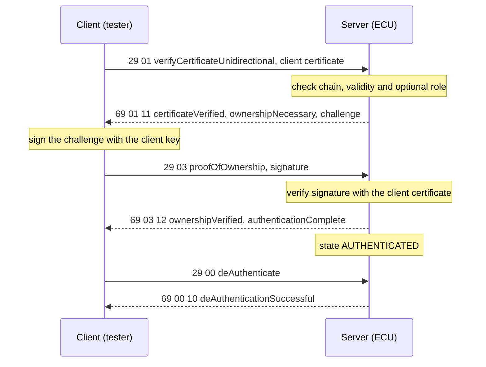
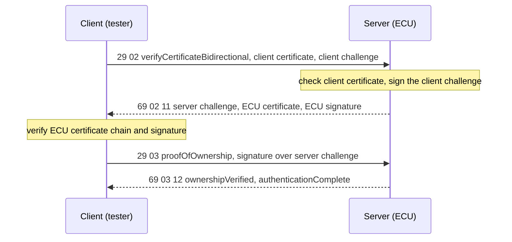

# Client and server roles

The toolkit implements both ends of ISO 14229-1:2020 SID 0x29 (Authentication) with certificate-based
authentication. Both sides are plain C11, use static memory only, and share the same codec, crypto port and OS port.

| | Client (tester) | Server (ECU) |
| --- | --- | --- |
| Header | `Uds29.h` | `Uds29_Server.h` |
| Prefix | `Uds29_` | `Uds29Srv_` |
| Sources | `Uds29.c`, `Uds29_Manager.c` | `Uds29_Server.c` |
| Drives | the 0x01/0x02 -> 0x03 flow, 0x00 | answers 0x00, 0x01, 0x02, 0x03, 0x08 |
| Transport | callback you provide (blocking), or TX callback + `Uds29_RxIndication` (non-blocking) | none: you call `Uds29Srv_HandleRequest` with each request and send what it writes |
| Identity | tester cert + key + root CA | ECU cert + key + root CA |
| Static RAM (defaults) | about 44 KB (41.7 KB exchange log) | about 5.3 KB |

## Unidirectional authentication (0x01, 0x03)

## Bidirectional authentication (0x02, 0x03)

A rejected step ends in a negative response `7F 29 <nrc>`: `0x50` certificate outside its validity period, `0x52` chain
of trust, `0x54` format, `0x56` scope (role), `0x58` ownership verification failed, `0x24` wrong order, `0x13` length,
`0x12` sub-function not supported. After a rejected certificate or proof the server is unauthenticated again.

## Server details

- **State** (`Uds29Srv_GetState`): `IDLE`, `CERT_SENT` (client certificate accepted, waiting for 0x03), `AUTHENTICATED`.
- **Auth timeout** (`auth_timeout_ms`, 0 = off): the server returns to `IDLE` that long after it entered `CERT_SENT` or
  `AUTHENTICATED`. It is enforced both by `Uds29Srv_MainFunction()` and at the start of every `Uds29Srv_HandleRequest()`. Requests
  do not extend it; the client authenticates again.
- **Roles and access control** (`profile`, `required_roles`, `Uds29Srv_SetAccessRules`, `Uds29Srv_CheckAccess`): after the
  chain check the server reads roles and allow-lists from the client certificate, in an OEM-defined format (extension OID,
  subject OU or CN), and can refuse certificates without a required role (NRC 0x56, or 0x55 if a value cannot be decoded).
  The access rule table then decides per service, DID and routine. See [access-control.md](access-control.md).
- **Events**: `Uds29Srv_SetEventCallback` reports state changes and a failure event for every NRC the server sends
  (`nrc != 0`) and for auth timeouts (`nrc == 0`, "authentication timeout"). The [IDSM bridge](../README.md#idsm-integration)
  can be attached with `Uds29_IdsM_InitServer`.
- **Not implemented**: 0x04-0x07 (answered with NRC 0x12), session key / ephemeral key agreement, certificate revocation.

## Choosing `UDS29_ROLE`

| Value | Builds into `libuds29` | Installs | Use for |
| --- | --- | --- | --- |
| `BOTH` (default) | client + server | `Uds29.h`, `Uds29_Server.h`, shared headers | development, tests, gateways, anything needing the simulated ECU, CLI or demos |
| `CLIENT` | client only | `Uds29.h`, shared headers | tester tool, diagnostic gateway toward an ECU |
| `SERVER` | server only | `Uds29_Server.h`, shared headers | ECU firmware (smallest RAM) |

The simulated ECU, `uds29_cli`, `linux_app`, the DoIP / CAN demos and every test except `test_codec` need `BOTH`; with
`CLIENT` or `SERVER` only the library and `test_codec` are built. Codec, crypto port and OS port are always included.

## API: client (`Uds29.h`)

| Function | Purpose |
| --- | --- |
| `Uds29_Init(cfg)` / `Uds29_DeInit()` | session config `{comm_config, challenge_len}` |
| `Uds29_SetTransport(fn, ctx)` | blocking transport: send request, return response |
| `Uds29_SetPki(pki)` | load client cert, key, root CA |
| `Uds29_SetEventCallback(cb)` | state changes and failures |
| `Uds29_AuthenticateUnidirectional()` / `...Bidirectional()` | run the flow (blocking) |
| `Uds29_DeAuthenticate()` | sub-function 0x00 |
| `Uds29_GetState()` | `IDLE`, `CERT_SENT`, `CHALLENGE_RECEIVED`, `POWN_SENT`, `AUTHENTICATED`, `FAILED` |
| `Uds29_SetTxCallback(fn, ctx)`, `Uds29_StartAuthentication(dir)`, `Uds29_StartDeAuthentication()`, `Uds29_MainFunction()`, `Uds29_RxIndication(resp, len)` | non-blocking flow with `UDS29_P2_TIMEOUT_MS` |
| `Uds29_SendRaw(req, len, resp, &n)` | send bytes as-is |
| `Uds29_GetLogCount/GetLogEntry/ClearLog` | TX/RX exchange log |

## API: server (`Uds29_Server.h`)

| Function | Purpose |
| --- | --- |
| `Uds29Srv_Init(&cfg)` | `Uds29Srv_ConfigType {pki, challenge_len (0 = 32), auth_timeout_ms (0 = off), profile, required_roles, deny_nrc, deny_unlisted_sid}`; `E_NOT_OK` on bad PKI or `challenge_len > UDS29_MAX_CHALLENGE_LEN` |
| `Uds29Srv_DeInit()` | release the identity, clear state |
| `Uds29Srv_HandleRequest(req, len, resp, &resp_len)` | full 0x29 request in, positive or `7F 29 nrc` response out; `E_OK` if a response was written, `E_MODE_INVALID` if not initialised, `E_NOT_OK` if it does not fit |
| `Uds29Srv_MainFunction()` | call cyclically: auth timeout |
| `Uds29Srv_IsAuthenticated()` | `true` in `AUTHENTICATED` |
| `Uds29Srv_GetState()` | `IDLE`, `CERT_SENT`, `AUTHENTICATED` |
| `Uds29Srv_SetEventCallback(cb)` | state changes and failure events |
| `Uds29Srv_SetAccessRules(rules, n)`, `Uds29Srv_CheckAccess(req, len, &nrc)`, `Uds29Srv_GetAuthz(&a)`, `Uds29Srv_SetAuthzParser(fn, ctx)` | certificate-based access control, see [access-control.md](access-control.md) |

Test-only hooks (`include/Uds29_ServerTest.h`, not installed): `Uds29Srv_SetFaultForTest(fault, nrc)` and
`Uds29Srv_SetClockForTest(fn)`. The C++ `Uds29SimEcu` is a thin wrapper over the server plus these hooks.
